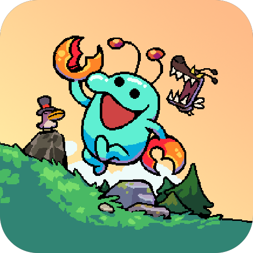

Everything is Crab invites you into a living ecosystem where you craft a unique creature each run and battle toward survival. The description emphasizes cute, challenging gameplay that repeats endlessly and adapts to evolving conditions. Because the title is not yet released, you can only pre‑register and wait for launch.

The game is positioned as a highly replayable action roguelite that mixes evolution choices with strategic combat and visual customization. Its promotional text highlights endless possibilities, genetics and challenge scenarios that test adaptation skills. No concrete details about control layout or session duration are provided.

## What Everything is Crab Is and What You Actually Do

The core loop asks you to select animal‑inspired evolutionary abilities and then guide your chimera through four distinct biomes while fighting bosses and surviving environmental hazards. Over 160 abilities combine to create varied builds and visual styles, and each run resets your creature but preserves meta‑progression data. The ecosystem features night and day cycles, climate events and multiple critters that pursue their own goals.

Meta‑progression is tracked in a Codex that records findings, achievements and unlocked content, and challenge scenarios like Ice Age or Always Night add extra constraints to each attempt. The game promises endless runs and a difficulty system that scales for daring players, yet the official page does not state how long a typical session lasts.

## Release Date and What Is Still Unknown

The listing marks the title as upcoming with pre‑registration available, and it confirms the game is not released yet. No specific release date is given, and the last‑update field is listed as n/a, so the timeline remains unclear. Because the status is upcoming, you cannot download or play the game at this time.

The app is slated for Android via Google Play, but the page does not enumerate supported devices or OS version requirements. Control scheme details such as touch or controller support are not mentioned, leaving input methods uncertain. Update frequency and future content plans are also not disclosed on the listing.

## Price and In-Game Spending

Everything is Crab is free to download, and the store listing does not mention any required purchase to begin playing. No in‑app purchase options, such as randomized items or cosmetic packs, are described in the official description. Consequently, the exact cost of any potential microtransactions remains unknown.

The page does not reference advertisements, subscriptions or paid expansions, so it is unclear whether any of these monetization models will appear. Information about price tiers for in‑game currency or premium bundles is not provided, leaving the financial commitment ambiguous. Overall, the monetary structure beyond the free download is not detailed.

## Who It Suits - and Who Should Skip
