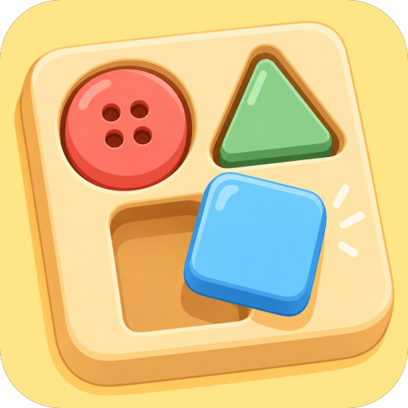

Snap Fit: Object Brain Puzzle is an upcoming free brain‑teaser that lets you rearrange items in multiple ways. Because it is not released yet, you can only pre‑register and wait for launch. If you enjoy short, casual puzzles with hint support, reserving a spot may be worthwhile.

The game promises quick rounds suitable for commuting and a calm hand‑drawn aesthetic. Controls involve dragging, sliding, tilting, and connecting, as described in the listing. However, details such as exact session duration and supported Android versions are not provided.

## What Snap Fit: Object Brain Puzzle Is and What You Actually Do
Snap Fit: Object Brain Puzzle is described as an object brain puzzle where the same items can be sorted in different ways to find hidden solutions. Players earn a star for each hidden answer they uncover, and they can request step‑by‑step hints when stuck. The listing does not specify how many items appear per stage or the exact actions required beyond drag, slide, tilt, and connect.

Each stage presents a quick round that can be completed in a short time, making it suitable for brief play sessions. The game’s hand‑drawn art and gentle sounds aim to provide a calm and cozy atmosphere while you work out the puzzles. The length of a typical session is not stated in the official page.

## Release Date and What Is Still Unknown
The store status shows the title as upcoming with pre‑registration, meaning it is not released yet. No release date is given in the listing, so the exact launch timing remains unknown. The last‑update field is marked n/a, indicating no prior updates have been recorded.

Because the game is not available, there is no information on early‑access pricing or launch bonuses. Device compatibility beyond the generic Android platform is not listed, so supported OS versions are unclear. Any future content updates or seasonal events are not mentioned in the current description.

## Price and In-Game Spending
Snap Fit: Object Brain Puzzle is listed as free to download on Google Play. The description does not mention any in‑app purchases, ads, subscriptions, or paid content. There is no detail about what, if anything, the store would take from you beyond the free download.

Since the game is not released, pricing for potential in‑game items or hint costs cannot be confirmed. The listing does not specify any currency or price for hints, stars, or extra stages. Therefore, any monetary commitment beyond the free download remains uncertain.

## Who It Suits - and Who Should Skip
Players who enjoy short, casual puzzle sessions and appreciate a calm visual style will likely find Snap Fit: Object Brain Puzzle appealing. The hint system and multiple sorting methods cater to users who like brain workouts without heavy time investment. The listing does not provide information on difficulty scaling or progression depth, which may affect long‑term engagement.
