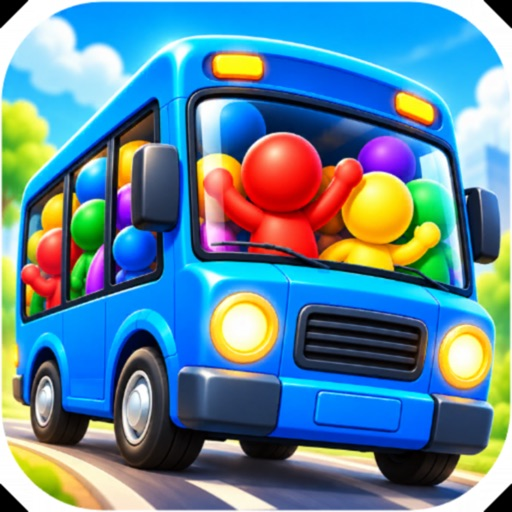

Busy Bus: Bus Jam Puzzle es un puzle de ordenar multitudes por color, todavía no disponible, que llegará a iPhone y iPad el 1 de noviembre de 2026. Cada nivel te pide llevar a cada pasajero hasta el autobús de su color tocándolo para que camine hasta la parada. La parada solo admite 7 personas en espera y, si la llenas, pierdes el nivel.

El juego llega en la versión 1.0.1 y se puede reservar ya en la App Store. Los autobuses tienen de 1 a 4 asientos y cada pocos niveles aparece un obstáculo nuevo. La descripción no aclara cuánto dura una partida ni cómo se juega en pantalla táctil más allá del toque.

## Qué es Busy Bus: Bus Jam Puzzle y qué haces en él

El objetivo de cada nivel es despejar la cola de pasajeros antes de que se sature la parada. Tocas a una persona, camina hasta la parada y sube al autobús de su color, pero solo avanza quien tiene el camino libre. Con 7 huecos de espera, mandar al pasajero equivocado bloquea la parada y termina la partida.

Hay 300 niveles repartidos en 9 mundos, del parque de la ciudad a la Luna, y cada mundo desbloquea aspectos de autobús en la tienda. Los obstáculos van desde bombas con cuenta atrás hasta pasajeros encadenados, hielo, hiedra, muros con candado, pasajeros misteriosos y túneles. Cuántos niveles hay por mundo no aparece indicado.

## Fecha de lanzamiento y lo que aún no se sabe

La ficha marca el 1 de noviembre de 2026 como fecha de lanzamiento y permite reservar el juego antes de esa fecha. No hay datos de un lanzamiento anterior ni de pruebas abiertas, y tampoco se indica cuánto tiempo lleva anunciado en la tienda. La reserva no incluye recompensas anunciadas.

Queda por confirmar el tamaño real de cada mundo y si los 300 niveles llegan todos el primer día. Tampoco se sabe cada cuánto se añadirán niveles nuevos ni si habrá eventos temporales. El ritmo de actualizaciones no está publicado.

## Precio y compras dentro del juego

El juego es gratis y se sostiene con anuncios y compras opcionales dentro de la aplicación. Los anuncios aparecen como parte del modelo, aunque no se detalla en qué momentos se muestran ni si se pueden quitar pagando. Las monedas se ganan al superar niveles y con recompensas diarias.

Esas monedas sirven para abrir aspectos de mundo y de autobús en la tienda, pero el precio de cada aspecto no está indicado. Tampoco se sabe si las compras son aleatorias o directas. Las mejoras son deshacer, imán, mezclar, autobús extra y martillo, y su coste tampoco aparece.

## Para quién es y para quién no

Encaja con quien busca puzles cortos de lógica y le gusta planificar varias jugadas por delante. Los 300 niveles y los nueve mundos dan margen para sesiones sueltas, y los obstáculos añaden variedad sin cambiar la mecánica base. Quien quiera avanzar sin ver anuncios debería pensarlo dos veces.

También debería saltárselo quien se frustre al perder un nivel por llenar la parada, porque el fallo llega rápido. La duración de una sesión no está confirmada, así que no hay forma de saber cuánto ocupa cada partida. Los dispositivos compatibles se limitan a iPhone y iPad según la ficha.
