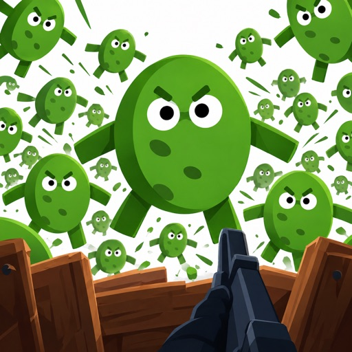

Pickle Battle est un jeu d'action dans lequel on survit à une invasion de cornichons vivants, en enchaînant des vagues d'ennemis de plus en plus coriaces. Le titre est signé David Ventre et se présente en français, avec une version 1.0 déjà affichée. Il n'est pas encore sorti : la fiche App Store le place en précommande pour le 1er novembre 2026.

Concrètement, la boucle annoncée tient en trois gestes : encaisser une vague, améliorer ses outils et son équipement, puis repartir affronter des cornichons aux capacités uniques. Le jeu promet une grande variété d'adversaires de ce type, sans détailler combien il en existe. Voilà tout ce que la fiche confirme sur le contenu réel.

## Qu'est-ce que Pickle Battle et à quoi on joue

Pickle Battle se décrit comme un jeu de survie par vagues : des cornichons vivants attaquent, et le joueur doit tenir le plus longtemps possible. La progression passe par l'amélioration des outils et de l'équipement entre les assauts, ce qui laisse entendre une montée en puissance à chaque tentative. La fiche évoque aussi des cornichons aux capacités uniques, donc des ennemis qui ne se comportent pas tous de la même façon.

En revanche, le schéma de contrôle n'est pas précisé : on ne sait pas si l'on vise au doigt, si l'on déplace un personnage ou si l'on se contente de toucher des cibles. La durée d'une session n'est pas indiquée non plus, et rien ne dit combien de vagues compte une partie. Ces trois points restent à découvrir avant de s'engager.

## Date de sortie et ce qu’on ignore encore

La sortie est annoncée au 1er novembre 2026, et l'application est déjà proposée en précommande sur l'App Store. Aucune date de dernière mise à jour n'accompagne cette version 1.0, ce qui est logique pour un titre pas encore publié. Le développeur, David Ventre, n'affiche pas d'historique de mises à jour sur cette fiche.

Le rythme des futures mises à jour n'est pas annoncé, pas plus que l'ajout de nouveaux cornichons ou de nouveaux équipements après la sortie. Aucune langue autre que le français n'est listée, et aucune région de disponibilité n'est détaillée. Il faut donc se contenter de la date de sortie et du statut de précommande.

## Prix et achats dans le jeu

Le téléchargement de Pickle Battle est gratuit, et c'est le seul élément tarifaire que la fiche affiche. Aucun prix d'objet, aucune monnaie interne, aucun abonnement et aucune publicité ne sont mentionnés dans la description. Rien n'indique non plus si des achats intégrés existent, ni s'ils portent sur des objets aléatoires.

Autrement dit, le modèle économique complet reste flou : impossible de savoir aujourd'hui combien coûte un outil amélioré ou un équipement supplémentaire. Le prix des objets dans le jeu n'est pas communiqué, et la présence éventuelle d'achats intégrés n'est pas confirmée. C'est le point à vérifier en premier si vous comptez éviter les dépenses cachées.

## À qui s'adresse-t-il - et à qui non
