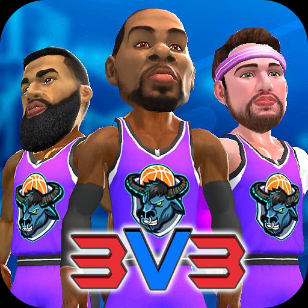

Basketball Slam MyTEAMは、Ranida Gamesが手がけるAndroid向けの3対3アーケードバスケットボールゲームで、現時点では配信されておらず事前登録を受け付けている段階にある。プレイヤーは自分だけのチームを作り、ハイペースな3対3の試合で世界中のチームと競うことになる。基本プレイは無料と表示されているが、実際にどこまで無料で遊べるかは配信後まで判断できない。

試合以外の要素も多い。スラムパックを開けて世界中の選手をアンロックし、選手をアップグレードして潜在能力を引き出し、アクセサリーで見た目を変えられる。ジャージやロゴでチームの外観を整え、デイリーミッションやミニゲーム、コートのアンロック、リーダーボード上位を狙う流れが用意されている。

## 「Basketball Slam MyTEAM」はどんなゲームか。何をするのか

中心にあるのは3対3のアーケードスタイルの試合で、相手は世界中のプレイヤーが作ったチームだ。試合に勝ちながらチームをレベルアップさせ、ランクを上げてバッジを集め、リーダーボードの上を目指す。コートも複数用意され、アンロックして遊び場を増やしていく仕組みになっている。

試合の操作方法や1試合あたりの所要時間は公表されていない。スラムダンクを狙う操作がボタンなのかスワイプなのかも不明で、片手で遊べるかどうかも分からない。短時間で何試合も回せる設計なのか、1試合に集中する設計なのかは、配信後の情報を待つしかない。

## 配信日とまだ明でない点

配信日は告知されておらず、事前登録の受付が始まっているという段階にとどまる。ストア上の最終更新日も記録がないため、いつから掲載されているのか、どのくらい開発が進んでいるのかを日付から読み取ることはできない。

対応端末や必要なOSのバージョン、対応言語の一覧も示されていない。事前登録をしても配信日に自動で入手できるのか、通知が届くだけなのかも明記がない。配信時期と対応環境は、投資を決める前に必ず確認したい項目になる。

## 価格とゲーム内課金

ダウンロードは無料で、そこから先の課金についてはスラムパックの存在だけが確認できる。選手を集める手段がこのパックである以上、欲しい選手を狙うにはパックを開ける必要があり、無料でどこまで揃うかは示されていない。

パックがランダム抽選なのか、有料通貨が何種類あるのか、価格がいくらなのかは公表されていない。広告の有無やサブスクリプションの用意も不明だ。選手の重複やハズレをどう扱うのかも分からず、課金の総額は配信後に自分で確かめるしかない。

## おすすめな人・おすすめしない人

短い試合を何度も回したい人、選手を集めて育てるのが好きな人、ジャージやロゴまで作り込んでチームの見た目を決めたい人には向いている。ミニゲームやデイリーミッションなど、試合以外の作業をコツコツ進めたい人も楽しめる構成だ。

一方、選手の入手方法がランダムなパックに限られる点を受け入れられない人は避けたほうがいい。課金の上限が見えないまま始めることになるため、予算を決めてから触りたい人には向かない。配信日も対応端末も決まっていない段階で動くのが不安な人も、発表を待つほうがいい。

配信日も対応端末も課金の詳細も公表されていないため、今できるのは事前登録をして続報を待つことだけだ。ランダムなパックで選手を集める仕組みが許容できるかどうかを基準に、登録するか見送るかを決めればいい。
