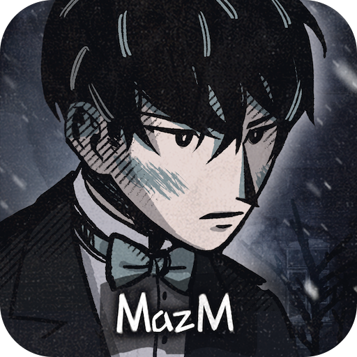

페치카 | 스토리게임 비주얼노벨 - Google Play 앱은 구글 플레이에서 지금 내려받을 수 있는 선택형 스토리 게임이다. 플레이어는 기록자이자 관찰자로 등장해 대화와 기록, 단서 확인을 통해 사건의 흐름을 따라간다. 주요 장면에서 고르는 선택이 인물 관계를 바꾸고, 쌓인 결과가 서로 다른 엔딩으로 이어진다.

비주얼노벨 형식의 장면 전개에 어드벤처 게임의 탐색 요소가 더해진다. 장소를 옮겨 다니며 기억과 단서를 모으고, 단서를 연결하는 순간마다 다음 선택의 파장을 고민하게 된다. 평가는 5점 만점에 4.2점이고 평가 수는 10,066개로 집계돼 있다.

## 페치카 | 스토리게임 비주얼노벨 - Google Play 앱 — 어떤 게임인가, 실제로 무엇을 하게 되나

하는 일은 크게 세 가지다. 인물과 대화하고, 기록을 남기고, 단서를 확인한다. 이 세 가지가 한 장면 안에서 엮이면서 사건이 굴러가고, 주요 장면에서 선택지가 열린다.

작은 선택도 관계를 바꾸고 누적된 결과는 엔딩을 갈라놓는다. 반복 플레이로 다른 선택지를 시도해 다른 감정선을 확인하는 구조다. 선택이 몇 개의 엔딩으로 갈리는지, 회차당 플레이 시간이 얼마인지는 확인되지 않는다.

## 페치카 | 스토리게임 비주얼노벨 - Google Play 앱 — 조작 방식과 한 세션, 필요한 기기

진행은 텍스트 중심이다. 정갈한 텍스트 리듬과 화면 구성 위에서 대화를 읽고 선택지를 고르는 방식이며, 장소를 옮겨 다니며 단서를 더한다. 전투나 실시간 조작을 요구하는 요소는 확인되지 않는다.

한 세션이 몇 분인지, 조작이 탭인지 드래그인지, 지원 기기 목록은 확인되지 않는다. 구글 플레이용으로 배포된 것은 분명하지만 그 외 플랫폼 지원 여부는 드러나 있지 않다. 최근 업데이트는 2026년 1월 12일로 표시돼 있다.

## 가격과 인게임 결제

내려받기는 무료다. MazM 멤버십을 구독 중이라면 같은 ID로 로그인해 이 게임의 모든 콘텐츠를 무료로 이용할 수 있다고 안내돼 있다. 즉 구독자는 별도 해금 없이 전체 분기를 볼 수 있는 쪽이다.

인게임 구매 항목의 종류와 가격, 확률형 아이템 여부는 확인되지 않는다. 광고가 붙는지, 유료로 여는 추가 콘텐츠가 있는지도 드러나 있지 않다. 결제를 결정하기 전에 이 부분은 직접 확인이 필요하다.

## 어떤 사람에게 맞고 누가 건너뛸 것인가

차분한 톤의 텍스트와 감정선, 선택의 무게를 중심에 두는 이야기를 원하는 사람에게 맞는다. 슬픈 결말과 여운을 감당할 수 있고, 반복 플레이로 다른 갈래를 파보는 쪽이라면 더 오래 붙잡을 수 있다.

반대로 빠른 손맛이나 전투, 경쟁, 짧은 세션으로 끊어 즐기는 방식을 원하는 사람은 건너뛰는 편이 낫다. 가장 큰 걸림돌은 인게임 결제 구조가 드러나 있지 않다는 점이고, 엔딩 개수와 전체 분량도 아직 알 수 없다.

무료로 시작할 수 있으니 먼저 도입부를 읽고 텍스트 중심 진행이 맞는지 판단하는 편이 안전하다. 결제 구조와 분량은 시작 전에 직접 확인해야 할 항목으로 남아 있다.
