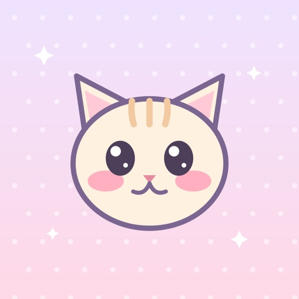

Purr: 포근한 고양이 집은 아직 출시되지 않았고 2026년 11월 1일 출시 예정으로 예약 주문이 걸려 있는 캐주얼 시뮬레이션 게임이다. 고양이에게 밥을 주고 쓰다듬고 깃털로 놀아 주면 골골송이 방을 채우는, 돌봄 중심의 작은 집 관리가 핵심이다. 가격은 무료로 표시되어 있어 지금 예약 자체에 돈이 드는지는 결제 화면에서 다시 확인해야 한다.

이 게임의 고양이는 배고프지도 아프지도 않고 영영 떠나지 않으며, 일주일 만에 돌아와도 반갑게 맞아 준다. 자리를 비운 동안 고양이마다 깃털이나 조개껍데기, 가끔은 별똥별까지 찾아 두고 선물을 들고 기다린다. 다만 한 번 접속했을 때 몇 분을 쓰게 되는지, 화면을 어떻게 조작하는지는 자료에 나오지 않는다.

## Purr: 포근한 고양이 집 — 어떤 게임인가, 실제로 무엇을 하게 되나

돌보면서 얻는 사료로 일반 고양이를 입양하고, 마법의 알에서 새 고양이를 부화시키거나 놀이로 얻은 티켓으로 미스터리 바구니를 연다. 60가지가 넘는 품종을 모을 수 있고, 발견한 레시피는 모두 레시피 북에 기록되며 전설 고양이는 반짝반짝 빛난다. 즉 이 게임의 수집 대상은 고양이와 레시피 두 갈래로 나뉜다.

미니게임은 비눗방울 터뜨리기, 낚시, 탁자 위 물건 떨어뜨리기, 물고기 잡기 등을 포함해 10종이 준비되어 있고, 놀면 고양이가 행복해지면서 사료도 함께 들어온다. 집 꾸미기는 7개의 꾸미기 자리, 13가지 가구, 10가지 벽지, 베레모부터 드래곤 날개까지 130가지 액세서리로 구성된다. 조작 방식과 한 세션의 길이는 확인되지 않아, 손가락으로 무엇을 누르는지 미리 알 수는 없다.

## 출시 시점과 아직 확인되지 않은 것

출시일은 2026년 11월 1일로 표시되어 있고, 앱 버전은 1.0이며 지원 언어는 한국어를 포함해 영어, 프랑스어, 독일어, 일본어, 스페인어, 중국어다. 예약 주문이 열려 있다는 사실은 확인되지만, 예약자에게 무엇을 주는지에 대한 설명은 자료에 없다. 출시일이 지켜질지, 앞당겨질지를 알려 주는 문구도 없다.

집이 가득 차면 고양이가 언덕 위 마을 빌라 미아우로 이사하고, 엽서를 보내 오며 언제든 놀러 갈 수 있고 어떤 고양이든 다시 집으로 돌아올 수 있다. 코드로 친구를 추가해 친구 집을 방문하고 간식을 남기면 양쪽 모두 아기 고양이를 받는다. 다만 업데이트 주기와 앞으로 추가될 품종 수는 어디에도 적혀 있지 않다.

## 가격과 인게임 결제

다운로드 가격은 무료이고, 선택 구매 항목으로 프리미엄 액세서리를 위한 반짝이, 집의 세 번째 자리, 두 번째 둥지, 시즌 케어 패스, 프리미엄 고양이 4마리가 제시되어 있다. 이 항목들은 모두 긴 무료 레시피로도 얻을 수 있다고 설명되어 있어, 결제 없이도 같은 것을 노릴 수 있는 구조다. 가격은 고정되어 있고 모두 표시되며, 돈으로 무작위 아이템을 사는 일은 없다고 명시되어 있다.

어린이 모드에서는 광고와 구매가 빠지고, 어른 확인 절차와 월별 지출 한도가 붙는다. 알림은 하루에 최대 한 번이고 밤에는 오지 않는다. 반짝이나 시즌 케어 패스의 실제 금액은 자료에 없어서, 얼마를 쓰게 될지는 결제 화면에서 확인해야 한다.

## 어떤 사람에게 맞고 누가 건너뛸 것인가

하루에 한 번 짧게 들어와 고양이를 쓰다듬고 사료를 모으는 정도로 만족하는 사람에게 맞는다. 미니게임 10종과 130가지 액세서리, 60가지가 넘는 품종 수집처럼 모으는 재미를 좋아하는 사람에게도 선택지가 많다. 코드로만 친구를 맺고 채팅과 낯선 사람이 없다는 점은 아이와 함께하는 집에 어울린다.

반대로 경쟁이나 빠른 손맛, 정해진 목표를 향해 밀어붙이는 진행을 원하는 사람은 건너뛰는 편이 낫다. 고양이가 아프지도 배고프지도 않고 떠나지도 않는 설계라서 실패하거나 잃는 긴장이 없다. 한 세션의 길이와 조작 방식이 공개되지 않은 점도 즉시 판단을 원하는 사람에게는 걸림돌이다.

가장 큰 걸림돌은 출시 전이라 실제 플레이 화면과 손맛을 확인할 방법이 없다는 점이다. 예약 주문은 무료 표시만 보고 결정하게 되므로, 반짝이 가격과 세 번째 자리 가격이 공개된 뒤에 판단해도 늦지 않다.
