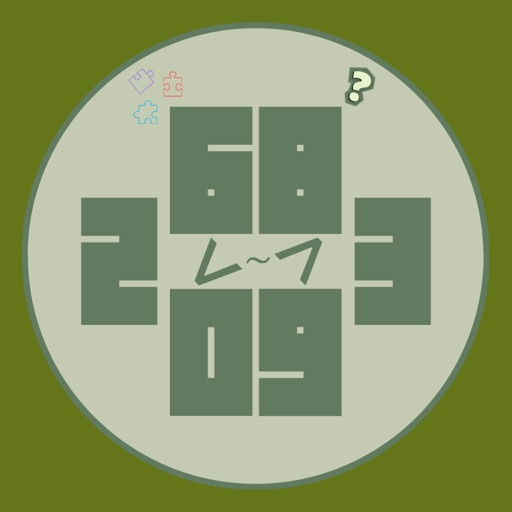

Close Call: Числовая викторина вышла 30 октября 2026 года и доступна сейчас в App Store для iPhone и iPad. Это казуальная викторина, где не нужно знать точный ответ: достаточно ввести число или год и оказаться ближе остальных. Разработчик — Arman Zohrabyan, версия 1.0, возрастной рейтинг 12+.

Вопросы разложены по четырём темам: «Вызов Времени» про изобретения и события, «Тело в Цифрах» про числа человеческого тела, «Мир в Цифрах» про страны и горы и «Числовые Упражнения» про быстрые прикидки. К каждому вопросу даётся картинка и 15 секунд на ответ. Точный ответ приносит 8 очков, остальные получают тем меньше, чем дальше от истины.

## Что такое Close Call: Числовая викторина и что в нём делают

Матч состоит из 8 вопросов, после которых пьедестал показывает, кто был точнее всех. В «Вызове Времени» ко многим ответам приложен короткий факт, так что игрок узнаёт новое по ходу раунда. Награды «Снайпер», «Молния» и «В ударе» отмечают точность и скорость.

Прогресс держится на 21 достижении в каждой игре и на графике навыков по каждой теме. Отдельно ведётся рейтинг за день, неделю и месяц. Сколько времени занимает один матч целиком, не указано.

## Как играть в Close Call: Числовая викторина: управление, сессия и устройство

Кнопка «Играть» сразу отправляет в быстрый матч, а «Играть с друзьями» создаёт закрытую игру на 2–8 человек со стартом по готовности. Друзей добавляют по ID и переписываются в чате. Гостем можно играть сразу, вход через Apple или Google сохраняет прогресс на любом телефоне.

Список поддерживаемых устройств охватывает модели от iPhone 5s до iPhone 18 Pro и iPad разных поколений. Как именно устроено управление вводом числа и сколько длится одна сессия, не раскрыто.

## Цена и покупки внутри игры

Скачивание бесплатное, и рекламы в игре нет — это указано прямо. Внутренние покупки в описании не упоминаются, их наличие и стоимость не раскрыты. Платных наборов вопросов, подписки или сезонов в материалах тоже нет.

Все четыре темы и 10 языков — русский, английский, армянский, немецкий, французский, испанский, итальянский, турецкий, грузинский и арабский — входят в бесплатную версию без оговорок. Обновляется ли игра по расписанию, неизвестно.

## Кому подойдет, а кому нет

Берите, если любите викторины без зубрёжки и хотите играть с друзьями по ссылке: вход гостем и матчи до 8 человек это позволяют. Публичные игры наказывают тех, кто вышел во время вопроса, — такой ответ получает 0 очков.

Пропустите, если ищете одиночную игру с точными ответами и понятной ценой: здесь побеждает догадка, а стоимость покупок не раскрыта. Рейтинг 0,0 при нуле оценок ничего не говорит о качестве.

Главная заминка в том, что игра бесплатна и без рекламы, но чем именно она зарабатывает, из описания не ясно. Перед установкой стоит выяснить, есть ли внутренние покупки и сколько длится один матч.
